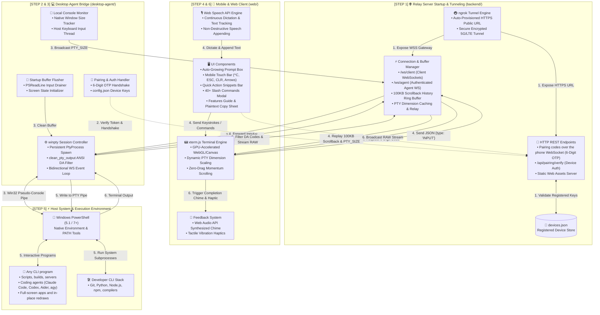

# 🚀 TermPilot

> **Your PC's terminal, on your phone**

TermPilot puts your Windows PC's coding agents and its live terminal on your phone. One app replaces each agent's own remote app: start Claude Code, Codex or Antigravity as a **chat** (replies, tool steps, diffs, Allow / Deny), or open the **terminal** to run anything you would run at the desk (shell commands, scripts, builds, servers, Aider, Antigravity `agy`), watch the output, and steer it by typing, voice or a touch key row, from anywhere.

## 💬 Chats with coding agents

The phone opens to a list of chats. **New chat** picks an agent and a folder on the PC; the agent then runs there in the background while you follow it on the phone, the way the agents' own mobile apps work.

* The PC agent drives each coding agent through the [Agent Client Protocol](https://agentclientprotocol.com) (`desktop-agent/acp_host.py`), so every agent shows up the same way: Markdown replies, one line per tool step, diffs for edits, and permission questions answered with the agent's own options.
* Modes that approve every tool without asking (`bypassPermissions`, `yolo`) are never offered on the phone.
* Chats survive a dropped connection, a locked phone and a relay restart; after a PC agent restart they reopen with the agent's own history.
* **Handoff between PC and phone** (like Happy): in the TermPilot terminal type `tp claude` instead of `claude`. Claude runs there as usual and appears in the phone's chat list as *In PC terminal*. **Take over** on the phone closes it on the PC and continues the same session as a chat, with its history; press Enter in the PC terminal (or **Give back to PC** on the phone) and it resumes there with everything said on the phone. Claude Code only for now: Codex picks its own session ids.
* **Any Claude window on the laptop**: a plain `claude` already running in any window (Windows Terminal, VS Code, PowerShell) shows in the chat list as *On laptop*. Once Claude is idle and the session has at least one message, **Take over** types `/exit` into that window and continues the session on the phone; **Give back to PC** types `claude --resume <id>` into the same window, so Claude comes back where it was. TermPilot finds these sessions through Claude Code's own records in `~/.claude/sessions`.
* **Alerts**: tap *Turn on alerts* on the home screen and the phone gets a notification when an agent needs your OK, finishes, or stops, while TermPilot is closed or the phone is locked. Tapping it opens that chat. The relay signs alerts with its own key (`backend/push.json`, gitignored) and sends them end-to-end encrypted through the browser's push service. On iPhone, add TermPilot to the Home Screen first (iOS 16.4+).
* **Attach files**: the 📎 button in a chat sends files (up to 100 MB each, 10 per message) from the phone. They are saved in `<project>/.termpilot/uploads` (a `.gitignore` inside `.termpilot` keeps them out of any repo), and the message tells the agent their full paths.
* **Files**: the file button in a chat's header lists the newest images, videos, audio, PDFs and documents in that chat's folder, with a preview, Open and Download. Files are served only from inside that folder, never from hidden folders (except `.termpilot`, so files you sent show too) or `node_modules`, through a random link that works for 10 minutes.
* **Past sessions**: on the home screen, lists your recent Claude Code and Codex sessions on the PC (from `~/.claude/projects` and `~/.codex/sessions`), including ones never started from TermPilot. Tap one to reopen it as a chat, with its history.
* **Agent health**: New chat shows why an agent cannot start (Node.js missing, not signed in) instead of failing after you tap Start. Only files and environment variables are checked; nothing is started.
* Setup, once: `npm ci --prefix desktop-agent/acp --ignore-scripts` installs the pinned Claude Code and Codex adapters. Each agent uses the login it already has on the PC.
* **Antigravity chats**: `agy` has no chat protocol, so `desktop-agent/agy_acp.py` runs `agy -p` for each message and turns its event stream into the chat. Antigravity cannot ask for your OK this way: it edits files in the chat's folder by itself and refuses shell commands, which the chat shows so you can run them in the terminal. A chat reopened after a PC agent restart continues the same conversation but starts with an empty screen.

---

## ⚡ Key Features

* **🎙️ Voice Dictation (Speech-to-Text)**: Live speech-to-text transcription with real-time text tracking.
* **📱 100% Native Mobile Kinetic Scroll**: Hardware-accelerated GPU momentum scrolling with zero drag and boundary containment.
* **⚡ Agent Slash Commands**: When a coding agent is running, `/` opens a searchable sheet of its commands (Claude Code, Codex, Aider, Antigravity).
* **📜 Smart Command History & Gestures**: Swipe left/right across the prompt box or tap `▲` / `▼` to cycle through recent prompts stored in `localStorage`.
* **📋 Native Mobile Long-Press Text Selection**: Long-press on the terminal to select text with blue pins, magnifying loupe, and native Copy/Share menus or 1-tap quick copy.
* **🔔 Task Completion Audio Alert**: Web Audio API synthesized melodic chime (`C5 -> G5`) automatically triggers when a long-running command finishes.
* **📳 Haptic Tactile Feedback**: Subtle vibration feedback on button presses, mic activation, swipe history navigation, and command execution.
* **🔒 Secure WebSocket Relay & Pairing**: 6-digit one-time token pairing and local network / ngrok tunneling.

---

## 🏗️ Comprehensive System Architecture & Execution Flow



---

### 🗺️ Step-by-Step Operational Lifecycle

| Step | Stage | What Happens |
| :--- | :--- | :--- |
| **`STEP 1`** | **Relay Startup** | `python main.py` starts the FastAPI backend, mounts static web assets, loads `devices.json`, provisions the public `ngrok` HTTPS tunnel, and initializes the 100KB rolling scrollback buffer. |
| **`STEP 2`** | **Device Pairing** | On first use, the mobile client requests a 6-digit OTP code. The desktop agent verifies the code via `python agent.py --pair <code>`, receiving an authenticated `device_id` and `secret_key` saved to `config.json`. |
| **`STEP 3`** | **PTY Session Spawn** | Desktop agent connects to `/ws/agent`, spawns a persistent PowerShell session using `winpty`, drains initial probe codes, and broadcasts native console dimensions (`PTY_SIZE`). |
| **`STEP 4`** | **Mobile Connect & Input** | Mobile client connects to `/ws/client`, immediately receives replayed scrollback history, dynamically scales font size to match `PTY_SIZE`, and sends typed, spoken (`🎙️`), or touch-bar (`▲`, `▼`, `⌃C`) commands as `{type: "INPUT"}` JSON payloads. |
| **`STEP 5`** | **Execution** | Input is piped to the persistent Win32 ConPTY. PowerShell and whatever it starts (scripts, builds, coding agents, full-screen apps) run exactly as they would at the desk. |
| **`STEP 6`** | **Output Stream & Feedback** | PTY output is filtered for device attribute artifacts and streamed over WebSocket to `xterm.js`. Upon command completion, a melodic Web Audio chime triggers and tactile haptic vibrations pulse. |

---

## 🚀 Quick Start

### 1. Prerequisites
* Python 3.10+
* Node.js and the agents you want to chat with (Claude Code, Codex, Antigravity `agy`), then `npm ci --prefix desktop-agent/acp --ignore-scripts`
* (Optional) `ngrok` for public remote phone access over 5G/LTE

### 2. Start the Backend Relay
```bash
cd backend
pip install -r requirements.txt
python main.py
```

### 3. Connect the Desktop Agent
```bash
cd desktop-agent
pip install -r requirements.txt
python agent.py
```
*(If pairing for the first time, run `python agent.py --pair <6-digit-code>` shown on your phone screen).*

### 4. Add your phone
Scan the QR code the relay prints with the phone's camera. The code works once, for 10 minutes. For another phone later, open `http://localhost:8000/enroll` on the PC and scan that one.

## 🔒 Phones and security
Anyone who can reach TermPilot can run code on your PC, so every phone has its own key.
* **Each phone has its own key.** The relay stores only a SHA-256 hash of it, in `backend/phones.json` (gitignored). A phone not used for 30 days must be added again.
* **Only the PC can add a phone.** The one-time code comes from the PC's screen (startup QR code or `/enroll`, which answers only to a browser on the PC itself). A stolen phone cannot add more phones.
* **Remove a phone** under **Devices** on the home screen. Its connection closes at once, its key stops working and its alerts stop. To remove every phone: `python main.py --remove-all-phones`.
* **Updates**: when the PC serves a newer web app, an open page shows *TermPilot was updated on the PC* with a Reload button, on reconnect or when you come back to the app.

### Check
```powershell
backendenv\Scripts\python.exe test_integration.py
```
Runs the phone, relay, PC agent and a fake ACP agent over real sockets in a throwaway home folder: adding and removing phones, attachments, the Files sheet, past sessions and agent health.

### Everyday start
After setup, double-click **TermPilot** on the desktop. Its window starts the relay and opens the PC terminal, shows when both are connected, copies the phone link, and opens the add-a-phone page. **Stop TermPilot** (or closing the window) stops everything. Nothing starts with Windows.

Make the desktop shortcut once:
```powershell
$s = (New-Object -ComObject WScript.Shell).CreateShortcut("$([Environment]::GetFolderPath('Desktop'))\TermPilot.lnk")
$s.TargetPath = "C:\Users\avina\termpilot\backend\venv\Scripts\pythonw.exe"
$s.Arguments = '"C:\Users\avina\termpilot\TermPilot.pyw"'
$s.WorkingDirectory = "C:\Users\avina\termpilot"
$s.Save()
```

Without the app, run one line in each of two PowerShell windows, relay first:
```powershell
cd C:\Users\avina\termpilot\backend; .\venv\Scripts\python.exe main.py
cd C:\Users\avina\termpilot\desktop-agent; .\venv\Scripts\python.exe agent.py
```

---

## 📄 License
MIT License. Created by [Astroash2001](https://github.com/Astroash2001).
